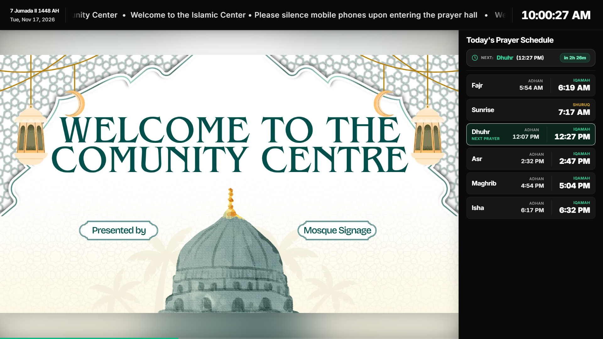

# MosqueSignage


**MosqueSignage** is an open-source, local-first digital signage appliance engineered for mosques, Islamic schools, community centers, and public venues. It turns any television or monitor into a clean, 24/7 informational display showing accurate prayer times, Friday Jummah schedules, announcements, event flyers, and videos.

While purpose-built with specialized liturgical intelligence for mosques, MosqueSignage is also a versatile, subscription-free digital signage system for any organization. With an optional 1-click **Poster-Only Mode**, you can completely disable prayer schedules and timetable sidebars to run a clean, full-screen announcement, flyer, and video rotation for schools, youth centers, community halls, or businesses.

Designed for 24/7 reliability, MosqueSignage runs on almost any hardware (such as an Intel N100 mini-PC, Raspberry Pi 4/5, desktop, or server) with **zero subscriptions, zero cloud fees, and complete data privacy**.



---

## Key Features

- **Dual Display Modes (Mosque & General Venue)**: Operate as a full mosque liturgical display with Adhan/Iqamah timetables, or switch with 1 click to **Poster-Only Mode** to run clean, full-screen announcement, video, and flyer broadcasts for schools, youth centers, community halls, or businesses with no prayer timings shown.
- **Automated Prayer Times & Jummah**: Calculates exact daily Adhan and Iqamah times using standard astronomical methods (ISNA, MWL, Makkah, Egyptian, Karachi) or custom annual CSV timetables. Easily manage multi-shift Friday Khutbahs.
- **In-Browser Poster & Notice Studio**: Upload flyers and looping videos (`.mp4`, `.webm`, `.mov`, `.webp`, `.png`) or design custom split-screen slides directly in your browser with geometric backgrounds, stickers, and text frames.
- **Universal TV Scaling**: Designed at 1080p (`1920x1080`) and auto-scales smoothly to 720p, 1440p, and 4K displays. Includes overscan protection to prevent television borders from cutting off text.
- **24/7 Unattended Reliability**: Built-in Screen Wake Lock prevents displays from sleeping, automatic Do-Not-Disturb silences the screen during congregational prayer, and midnight date rollover automatically calculates tomorrow's schedule without refreshing.
- **TV Auto-Power & Audio Muting**: Automatically put the TV screen into low-power standby at night, and optionally mute prayer hall audio receivers (Denon, Yamaha, or HTTP webhook) during Iqamah.
- **Multi-Browser & PWA Kiosk**: Works on Google Chrome, Chromium, Firefox, Microsoft Edge, and Safari. Can also be installed in 1 click as a standalone Progressive Web App (PWA) with zero browser toolbars or address bars.
- **Easy Administration & Security**: User-friendly admin dashboard with an on-screen tactile keypad for lobby touchscreens, username/password support for remote access, and an emergency terminal recovery command if credentials are forgotten.
- **100% Offline & Private**: All data is stored in an embedded SQLite database on the local machine. No third-party servers, tracking, or recurring monthly bills.

---

## Getting the Code

You can obtain MosqueSignage in one of two ways:

### Option A: Clone with Git (Recommended for all platforms & Docker)
```bash
git clone https://github.com/GitCreativeCode/mosque-signage.git
cd mosque-signage
```

### Option B: Download Release ZIP (No Git required)
Download the latest release ZIP from the [Releases page](https://github.com/GitCreativeCode/mosque-signage/releases) and extract it to a folder on your computer.

---

## Setup & Running by Platform

### 1. Windows (Recommended Setup)
1. Ensure **[Node.js 22 LTS or newer](https://nodejs.org/)** is installed.
2. Open PowerShell, Command Prompt, or Windows Terminal in the extracted project folder.
3. Install dependencies and start the appliance:
   ```bash
   npm install
   npm start
   ```
4. Open your browser:
   - TV Display Screen: `http://localhost:3000/display`
   - Admin Control Panel: `http://localhost:3000/admin` *(Default PIN: `1234`)*
5. **Updating**: See [Updating on Windows](#updating-on-windows) below for Git and ZIP update instructions.

### 2. Linux & Raspberry Pi (Raspberry Pi OS / Ubuntu / Debian)
1. Ensure **Node.js 22+** is installed (`node -v`).
2. Run the startup script:
   ```bash
   chmod +x start-signage.sh update.sh
   ./start-signage.sh
   ```
3. **Updating**: Run `./update.sh` or see [Updating on Linux](#updating-on-linux--raspberry-pi).

### 3. macOS
1. Ensure **Node.js 22+** is installed (`node -v`).
2. Run the startup script:
   ```bash
   chmod +x start-signage.sh update.sh
   ./start-signage.sh
   ```
3. **Updating**: Run `./update.sh` or see [Updating on macOS](#updating-on-macos).

### 4. Docker Deployment (Zero-Config)
The repository includes a ready-to-run `docker-compose.yml` that builds the container and sets up persistent local storage volumes (`mosque_data` and `mosque_uploads`):
```bash
# Start container in background
docker compose up -d

# To update container with latest code:
git pull
docker compose up -d --build
```

---

## Updating MosqueSignage

When a new release or security patch is published, choose the instructions for your operating system:

### Updating on Windows

- **Method A: If you installed with Git (Recommended)**
  Open your terminal in the MosqueSignage folder and run:
  ```bash
  git pull origin main
  npm install
  npm run build
  npm start
  ```
  *(Your database and media files are completely preserved).*

- **Method B: If you downloaded a ZIP release**
  1. Download the new release `.zip` from [GitHub Releases](https://github.com/GitCreativeCode/mosque-signage/releases) and extract it to a new folder (e.g. `C:\MosqueSignage-v0.2.0`).
  2. Open Command Prompt or PowerShell in the new folder and run:
     ```bash
     npm install
     npm run migrate-data "C:\Path\To\Previous\MosqueSignage"
     npm start
     ```
     The built-in `migrate-data` command automatically:
     - Backs up any existing database in the target folder.
     - Copies your SQLite database (`signage.db`) and WAL journals.
     - Copies your session secrets and all uploaded posters, flyers, and looping videos.
     - Merges custom frame styles without overwriting new default frames.
  *(Alternatively, you can manually copy the `data\` and `public\uploads\` folders from the old folder to the new folder).*

### Updating on Linux & Raspberry Pi

- **Method A: 1-Click Script**
  ```bash
  ./update.sh
  ```
- **Method B: Git**
  ```bash
  git pull origin main && npm install && npm run build && ./start-signage.sh
  ```
- **Method B: ZIP Release**
  Extract the new `.zip`, open a terminal in the new folder, and run:
  ```bash
  npm install
  npm run migrate-data "/path/to/old/mosque-signage"
  ./start-signage.sh
  ```

### Updating on macOS

- **Method A: 1-Click Script**
  ```bash
  ./update.sh
  ```
- **Method B: Git**
  ```bash
  git pull origin main && npm install && npm run build && ./start-signage.sh
  ```
- **Method C: ZIP Release**
  Extract the new `.zip`, open a terminal in the new folder, and run:
  ```bash
  npm install
  npm run migrate-data "/path/to/old/mosque-signage"
  ./start-signage.sh
  ```

### Updating with Docker

```bash
git pull origin main
docker compose up -d --build
```
*(Data stored in persistent Docker volumes `mosque_data` and `mosque_uploads` is permanently retained).*

---

## TV Screen & Browser Presentation

> [!IMPORTANT]
> **Keep the MosqueSignage Server Running**  
> MosqueSignage is an appliance server. The background application (`npm start`, `./start-signage.sh`, or Docker) must remain active for TV displays, kiosks, and admin portals to load. If the server is stopped, screens will show a connection error. The kiosk scripts automatically wait for the server to become healthy before opening.

### Access URLs: Host Computer vs Other Devices on Wi-Fi

| Access Location | TV Display Screen | Admin Control Panel | Default Credentials |
| :--- | :--- | :--- | :--- |
| **On This Machine (Host PC)** | `http://localhost:3000/display` | `http://localhost:3000/admin` | PIN: `1234` |
| **From Other Devices on Same Wi-Fi / LAN** *(Smart TVs, Tablets, Laptops)* | `http://<HOST-IP>:3000/display`<br>*(e.g. `http://192.168.1.50:3000/display`)* | `http://<HOST-IP>:3000/admin`<br>*(e.g. `http://192.168.1.50:3000/admin`)* | PIN: `1234` |

> [!TIP]
> **Why `localhost` only works on this computer**:  
> `localhost` (`127.0.0.1`) is a loopback address meaning *"this exact device"*. If you enter `localhost` into a Smart TV, phone, or another laptop, that device looks for a server on *itself* and reports *"Site can't be reached"*.  
> To find your host computer's local IP address:
> - **Windows**: Open Command Prompt or PowerShell and run `ipconfig` (look for *IPv4 Address*, e.g., `192.168.1.50`).
> - **Linux / Raspberry Pi**: Run `hostname -I` or `ip -4 addr`.
> - **macOS**: Open Terminal and run `ipconfig getifaddr en0`.

### Display & Kiosk Options

- **Fullscreen Kiosk Mode**: Press **`F`** or **`F11`** on any attached keyboard to enter fullscreen mode.
- **PWA Standalone App**: In Chrome, Edge, or Safari, click the Install icon in the address bar (or use the PWA prompt in the Admin Panel) to install MosqueSignage as a dedicated desktop application with zero browser tabs or URL bars.
- **Raspberry Pi Chromium Autostart**: On Raspberry Pi OS, configure unattended kiosk mode by launching Chromium with:
  ```bash
  chromium-browser --kiosk --noerrdialogs --disable-infobars --check-for-update-interval=31536000 http://localhost:3000/display
  ```
- **Windows Host Autostart (Run on the PC where MosqueSignage is installed)**:
  Open PowerShell or Command Prompt in your MosqueSignage folder and run:
  ```bash
  # Interactive menu (choose TV Display Mode or Server-Only Mode):
  npm run autostart

  # Or 1-click commands:
  npm run autostart -- --display   # This PC is plugged into the TV (local server + fullscreen TV kiosk)
  npm run autostart -- --server    # Background server only (other devices connect over Wi-Fi)
  npm run autostart -- --remove    # Disables autostart
  ```
  *(Check status anytime with `npm run autostart -- --status`).*
- **Auto-Opening the Display on a Separate TV Device After Reboot** *(No Node.js or installation needed on the TV device!)*:
  First, check the **`Connect TV`** link printed automatically in your terminal under *Remote Screens & Mobile* when you run `npm start` on the server PC (for example, `http://192.168.1.50:3000/display`):
  - **Windows / macOS / Linux TV PC (Easiest — Zero Commands)**:
    1. Open Microsoft Edge or Google Chrome on the TV computer and go to `http://<YOUR-SERVER-IP>:3000/display`.
    2. Click the **Install App** icon in the browser's address bar.
    3. Open `edge://apps` (in Edge) or `chrome://apps` (in Chrome), right-click **MosqueSignage**, and enable **Auto-start on device login** *(or "Start app when you sign in")*.
  - **Raspberry Pi TV Client**: Add `Exec=chromium-browser --kiosk --noerrdialogs --disable-infobars http://<YOUR-SERVER-IP>:3000/display` in `~/.config/autostart/mosque-signage-display.desktop`.
  - **Android TV / Fire TV / Smart TV**: Use a kiosk launcher app (such as *Fully Kiosk Browser*) set to launch `http://<YOUR-SERVER-IP>:3000/display` on device boot.

---

## Application Routes & APIs

| Route | Purpose | Access Level |
| :--- | :--- | :--- |
| `/` | Root redirect to kiosk display (`/display`) or overview | Public |
| `/display` | Fullscreen 1080p kiosk broadcast screen for prayer halls | Public |
| `/admin` | PIN/Password protected administrative control panel (`POSTERS`, `PRAYERS`, `SETTINGS`) | Admin Authenticated |
| `/faq` & `/faq/[slug]` | Interactive searchable appliance knowledge base & illustrated guides | Public |
| `/releases` | Built-in changelog and appliance release history | Public |
| `/privacy` & `/terms` | Local appliance privacy and terms disclosures | Public |
| `/api/posters` | Live active posters JSON endpoint for kiosk reconciliation | Public |
| `/api/sse/display` | Real-time Server-Sent Events stream for connected displays | Public (Pairing protected if enabled) |
| `/api/health` | Runtime server & database health check endpoint | Public |
| `/api/system/version` | Latest release check against `GitCreativeCode/mosque-signage` | Public |
| `/api/system/update` | Authenticated appliance update endpoint | Admin Authenticated |

---

## Common Edge Cases & Troubleshooting

- **Node.js Version (< 22)**: MosqueSignage uses native Node.js SQLite features (`DatabaseSync`) and requires Node.js version 22 or newer. If you see SQLite import errors, verify your version with `node -v` and update from [nodejs.org](https://nodejs.org/).
- **Port 3000 in Use**: If another service is already using port 3000, you can start MosqueSignage on another port:
  - *Terminal/Scripts*: Set `PORT=3001` before starting (`PORT=3001 npm start`).
  - *Docker*: In `docker-compose.yml`, change `ports: - "3000:3000"` to `ports: - "3001:3000"`.
- **Forgot Admin PIN / Password**: Open a terminal on the host computer and run:
  ```bash
  npm run reset-pin
  ```
  Follow the prompts to set a new PIN. This immediately resets brute-force lockout delays. If using Username + Password mode, run `npm run reset-auth`.
- **"Site Can't Be Reached" on Another Device**: If a Smart TV, tablet, phone, or laptop cannot open the signage:
  1. Verify the server is running on the host machine (`npm start`, `./start-signage.sh`, or Docker).
  2. Make sure you are using the host computer's local network IP address (e.g. `http://192.168.1.50:3000/display`), **not** `localhost`.
  3. Ensure both the host computer and the display device are connected to the same Wi-Fi / router.
  4. Ensure Windows Defender Firewall allows incoming connections on port 3000.
- **Uncommitted Changes During Update**: If you modified local files and `git pull` or `./update.sh` warns of conflicts, run `git stash` before pulling updates.
- **`npm install` Security & Script Notices**: MosqueSignage has **0 production runtime vulnerabilities** (verify anytime with `npm audit --omit=dev`). Any `picomatch` notice from `npm audit` originates strictly from build/test-time developer tools (`tailwindcss`/`vitest`) and is never exposed at runtime — do **not** run `npm audit fix --force`. On newer npm versions, any `esbuild` `install-scripts` notice is safe to ignore (native prebuilt binaries are already used automatically).

---

## Running Automated Tests

MosqueSignage includes a comprehensive automated verification suite:
```bash
npm test                # Runs all 46 test suites (483 tests)
npx tsc --noEmit        # Strict TypeScript type safety verification
npm run test:security   # Runs targeted security, auth, and penetration test checks
```

---

## Contributing & Community Support

- Found a bug or have a suggestion? Please open an issue on GitHub or reach out to `helpdesk.guidance@gmail.com`.
- We welcome community contributions! Please review [CONTRIBUTING.md](CONTRIBUTING.md) before submitting pull requests.

---

## License

MosqueSignage is open-source software licensed under the **GNU General Public License v3.0 (GPLv3)**. See [LICENSE](LICENSE) for full details.
